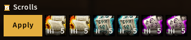
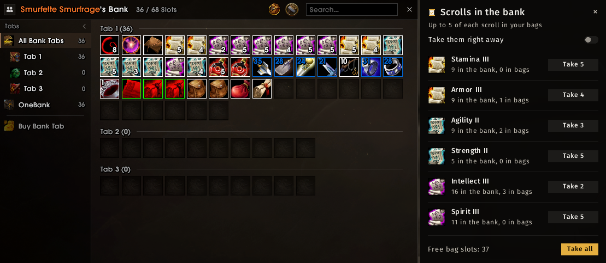
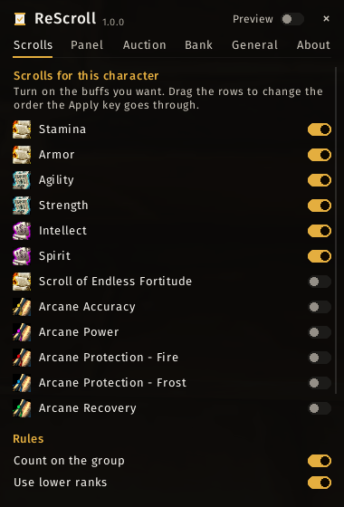

# ReScroll: Scrolls Reminder & ReStock

Shows which scroll buffs you are missing in WoW Forever, makes them easy to apply and restocks scrolls from the auction house and the bank.

## What it tracks

- Scroll of Stamina, Protection, Agility, Strength, Intellect and Spirit, all four ranks
- Forever scrolls: Endless Fortitude and the Arcane scrolls (off by default, switch them on per character)

Each character gets its own set. Stamina and Protection are on for every class, the rest depends on the class:

- Warrior and rogue: Agility, Strength
- Hunter: Agility, Intellect
- Paladin: Strength, Intellect, Spirit
- Priest and mage: Intellect, Spirit
- Warlock: Intellect
- Shaman and druid: all four

Switch any scroll on or off on the Scrolls tab of the settings.

## How it decides

- **Already on you:** a scroll buff, or a class buff that is at least as strong (Power Word: Fortitude covers Stamina, Arcane Intellect covers Intellect, Divine Spirit covers Spirit). Nothing to do.
- **You can cast it yourself:** a mage gets an Arcane Intellect button instead of a scroll, a priest gets Fortitude.
- **The group gives it:** a priest or mage in the group whose buff is stronger than your scroll. Shown dimmed with a dot in their class color, not counted as missing.
- **Runs out soon:** less than 5 minutes left (adjustable), with a timer. Click to refresh.
- **Stronger rank in your bags:** offered as an upgrade.
- **Missing:** click to apply. The best rank for your level is used, or a lower one if that is all you have.
- **Out of scrolls:** shown dimmed with 0, so you know what to buy.

Stacking rules come from the server and may differ from Classic. When a scroll bounces off a stronger buff ("A more powerful spell is already active"), the addon remembers which buff blocked it and stops offering that scroll while the buff is on you.

## Applying

- Click an icon to apply that scroll to yourself. Scrolls always go on you, even with a friendly target.
- **Apply** goes through the missing buffs one by one. Bind a key to it in the settings (General tab) or in the game's key bindings, then press it a few times.
- Right-click an icon to hide it until you change zones.

The panel shows up out of combat when something is missing: always (the default), in a group (and in any dungeon or raid), or only on a ready check. On a ready check it also shows up for 40 seconds and flashes.

## Auction house

When you open the auction house, a panel next to it lists the scrolls you are short of, up to the stock you keep (5 of each by default). Scrolls in the bank count toward it; switch off "Count scrolls in the bank" right in the panel to buy the full stock for your bags. Buffs you cast yourself are left out.

- The strongest rank on sale is chosen by default. Under each scroll all four ranks are listed with their bonus and price per scroll; click another rank to buy it instead, and your pick is remembered. Ranks above your level, switched off or not for sale are shown locked. Hover a rank for how many are on sale at that price and what comes after.
- The stock counts the rank you buy and higher ones. With 2 scrolls of rank IV and 3 of rank III you keep 2 of 5 rank IV scrolls, and the panel offers 3 more of rank IV. Pick rank III instead and the same bags hold 5 of 5.
- Lower ranks are listed when "Use lower ranks" is on. Turn it off to keep and buy only the best rank.
- **Price jump guard.** A purchase takes only scrolls priced at most 20% (adjustable) above the cheapest one. If 4 scrolls cost 15s and the fifth costs 1g, the panel buys 4 and tells you the rest is dearer.
- **Buy N** buys that scroll in one click. If the price went up since the lookup, the row asks you to confirm the new price.
- Rows show when a scroll is not for sale or you are short of gold.

## Bank

When you open the bank, a panel next to it lists the scrolls your bags are short of and how many of them are in the bank. **Take all** moves them into your bags, the best rank first and only ranks the stock counts, splitting stacks so you get exactly the stock. Each row has its own **Take** button. Turn on "Take them right away" to skip the click.

Both panels sit to the right of their window and follow it, also when a bag addon such as EllesmereUI replaces the bank window. Drag a panel to move it, or set its offsets in the settings; right-click a panel to open or close its settings, middle-click to put it back.

## Settings

`/scrolls` opens the settings:

- **Scrolls:** which buffs to track and in what order (drag the rows), counting on the group, lower ranks, upgrades, scrolls you are out of, the refresh threshold, how many scrolls to keep
- **Panel:** when it shows up, icon size, icons per row, spacing, which way it grows, the title line, scroll counts, lock
- **Auction:** the auction house list, counting the bank, the price jump guard, where the panel sits
- **Bank:** the bank panel, taking scrolls from the bank right away, where the panel sits
- **General:** the Apply key, minimap button, language

The preview switch at the top shows the panel with sample scrolls in every state.

