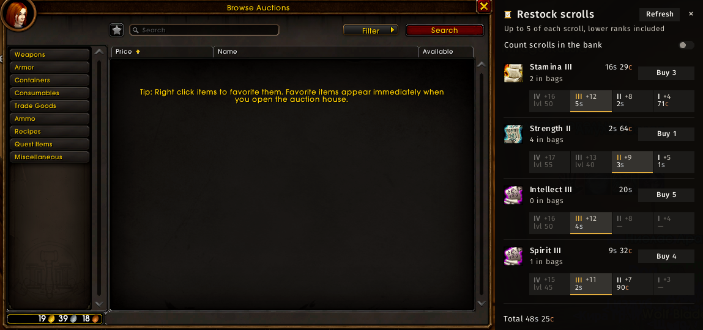

# ReScroll: Scrolls Reminder & ReStock

Shows which scroll buffs you are missing in WoW Forever, applies them from a button or a key and restocks scrolls at the auction house and the bank.

## What it tracks

- Scroll of Stamina, Protection, Agility, Strength, Intellect and Spirit, all four ranks
- Mage familiars: Rat, Frog and Cat Familiar, +2, +6 and +12 Intellect for an hour
- Forever's Arcane scrolls for mages (off by default, switch them on per character)

Scrolls only one class can use, like the familiars and the Arcane scrolls for mages, are listed only for that class.

Each character gets its own set. Stamina and Protection are on for every class, the rest depends on the class:

- Warrior and rogue: Agility, Strength
- Hunter: Agility, Intellect
- Paladin: Strength, Intellect, Spirit
- Priest: Intellect, Spirit
- Mage: Intellect, Spirit, Familiar
- Warlock: Intellect
- Shaman and druid: all four

Switch any scroll on or off on the Scrolls tab of the settings. Each scroll you switch on gets a **Keep in bags** slider: one stack (5) by default, up to two stacks.

## How it decides

- A scroll buff already on you, or a class buff that is at least as strong, hides the scroll: Power Word: Fortitude covers Stamina, Arcane Intellect covers Intellect, Divine Spirit covers Spirit.
- If you can cast the buff yourself, the panel offers the spell instead of a scroll: Arcane Intellect for a mage, Fortitude for a priest.
- If a priest or mage in the group gives a stronger buff than your scroll, the scroll is dimmed with a dot in their class color and is not counted as missing.
- With less than 5 minutes left (adjustable) the icon shows a timer. Click it to refresh the buff.
- A stronger rank in your bags than the active one is offered as an upgrade, with its rank in green.
- A missing buff uses the best rank for your level, or a lower one if that is all you have.
- A scroll you are out of stays dimmed with a red 0, so you know what to buy.

Stacking rules come from the server and may differ from Classic. When a scroll bounces off a stronger buff ("A more powerful spell is already active"), the addon remembers which buff blocked it and stops offering that scroll while the buff is on you.

## Applying

- Click an icon to apply that scroll to yourself. Scrolls always go on you, even with a friendly target.
- **Apply** goes through the missing buffs one by one. Bind a key to it in the settings (General tab) or in the game's key bindings, then press it a few times.
- Hover an icon for the scroll's own tooltip, with your stock and the ranks in your bags added under it.
- Right-click an icon to hide it until you change zones.
- Drag the title line, or Alt-drag an icon or **Apply**, to move the panel; middle-click any of them to put it back.

The panel shows up out of combat when something is missing: always (the default), in a group (and in any dungeon or raid), or only on a ready check. On a ready check it also shows up for 40 seconds and flashes.

## Utility scrolls

Mages have scrolls that are not buffs: you use them when the moment comes. Teleport to a party member resting at an inn (Liminal Passage), bring a dead player back (Reintegration), open a lock (Khadgar's Unlocking), turn a target into a melon or hit a group with Cryoblast. Other classes don't see this section.

Switch on the ones you carry at the bottom of the Scrolls tab and set how many to keep, the same as for buff scrolls. A second small panel shows how many you have: amber below the stock, red at 0. By default it shows only the scrolls you are short of and hides when you have enough of all; you can also show it always or never.

- Click an icon to use the scroll, the same as right-clicking it in your bags. Khadgar's Unlocking turns the cursor into a lockpick: click the chest, door or lockbox next. Polymorph goes on your target.
- Right-click an icon to open its settings. Drag the title line or Alt-drag an icon to move the panel, middle-click to put it back.
- The bank panel takes them up to the stock, and the auction house panel buys the ones that can be traded. Polymorph, Confuse Beast and Rebuke Elemental bind when picked up, so they never show up on the auction house.

## Auction house

When you open the auction house, a panel next to it lists the scrolls you are short of, up to the stock you keep for each scroll (5 by default). Scrolls in the bank count toward it; switch off **Count scrolls in the bank** on the panel or on the Auction tab to buy the full stock for your bags. Buffs you cast yourself are left out. The panel looks up a price only when it has none: when you press **Find price** on a row or **Find all prices** under the list, or pick a rank without a price, so opening the auction house to sell things doesn't slow it down. If you have Auctionator, a row shows its price with ≈ and **Buy** works without a search: the purchase goes through when the total is at most 20% (the price jump guard, adjustable) above that price, otherwise the row shows the real total and waits for **Confirm**. Prices it found stay until you close the auction house: buying, picking another rank or a change in your bags is counted from them without a new search. **Refresh** looks every price on the panel up again, right-click a rank to look up only its price, right-click a row for all its ranks. A search you make yourself, in Auctionator or the auction house window, also fills in the row.

- The strongest rank on sale is chosen by default. Under each scroll all four ranks are listed with their bonus and price per scroll; click another rank to buy it instead, and your pick is remembered. Ranks above your level, switched off or not for sale are shown locked. Hover a rank for how many are on sale at that price and what comes after.
- The stock counts the rank you buy and higher ones. With 2 scrolls of rank IV and 3 of rank III you keep 2 of 5 rank IV scrolls, and the panel offers 3 more of rank IV. Pick rank III instead and the same bags hold 5 of 5.
- Lower ranks are listed when "Use lower ranks" is on. Turn it off to keep and buy only the best rank.
- The **Price jump guard** takes only scrolls priced at most 20% (adjustable) above the cheapest one. If 4 scrolls cost 15s and the fifth costs 1g, the panel buys 4 and tells you the rest is dearer.
- **Buy N** buys that scroll. If the price went up since the lookup, the row asks you to confirm the new price.
- Rows show when a scroll is not for sale or you are short of gold.

## Bank

When you open the bank, a panel next to it lists the scrolls your bags are short of and how many of them are in the bank. **Take all** moves them into your bags, the best rank first and only ranks the stock counts, splitting stacks so you get exactly the stock. Each row has its own **Take** button. Turn on **Take when the bank opens** to skip the click.

Both panels sit to the right of their window and follow it, also when a bag addon replaces the bank window. They share the space with the panels of the other Re addons. On the Auction and Bank tabs you can attach the panel to the window or to another addon's panel, to the right, left, below or above. Drag a panel to move it; right-click it to open or close its settings, middle-click to put it back.

## Settings

`/scrolls` (or `/rescroll`) opens the settings:

- The Scrolls tab picks which buffs to track and in what order (drag the rows), how many of each to keep, the utility scrolls and when their panel shows up, and the rules: counting on the group, lower ranks, upgrades, the refresh threshold.
- The Panel tab sets when the panel shows up, whether scrolls you are out of stay on it, icon size, icons per row, spacing, which way it grows, the title line, scroll counts, the lock and the background of the panels.
- The Auction tab turns the auction house list on or off and sets counting the bank, the price jump guard and where the panel sits.
- The Bank tab turns the bank panel on or off and sets taking scrolls when the bank opens and where the panel sits.
- The General tab turns the panels on or off and has the Apply key, the minimap button and the language.

The preview switch at the top shows the panel with sample scrolls in every state.

## Other Re addons

Panels like this one for the other things you carry:

- [RePotion](https://www.curseforge.com/projects/1815534) gives you one button per potion type (health, mana, Free Action) and restocks them at the auction house and the bank ([GitHub](https://github.com/Jagerente/RePotion)).
- [ReFood](https://www.curseforge.com/projects/1816338) eats and drinks the strongest food you carry, reminds you of Well Fed and restocks food at the vendor, the auction house and the bank ([GitHub](https://github.com/Jagerente/ReFood)).
- [ReReagent](https://www.curseforge.com/projects/1816458) counts the reagents your class spells use and restocks them at the vendor and the bank ([GitHub](https://github.com/Jagerente/ReReagent)).
- [ReWeapon](https://www.curseforge.com/projects/1816469) puts sharpening stones, oils and poisons on your weapons with one button per hand and restocks them at the vendor, the auction house and the bank ([GitHub](https://github.com/Jagerente/ReWeapon)).
